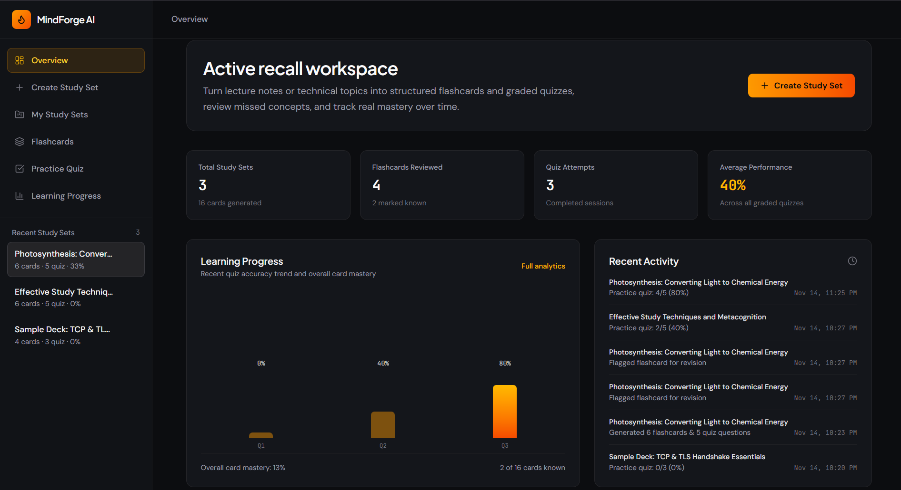
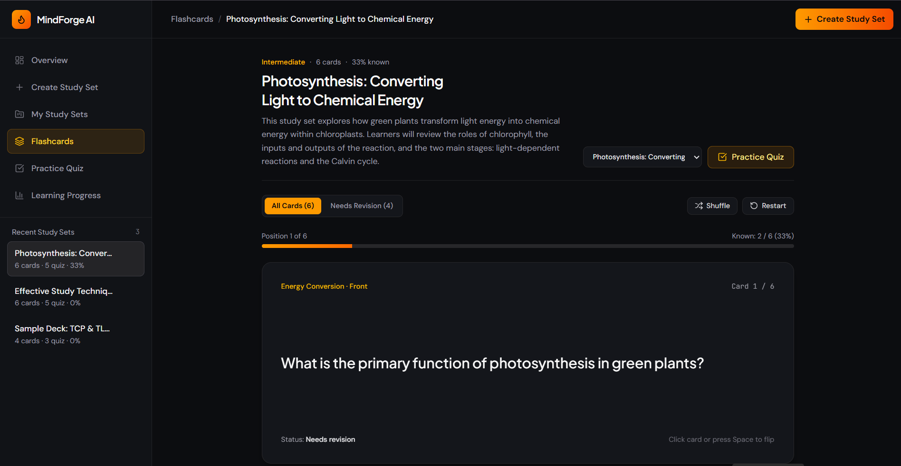
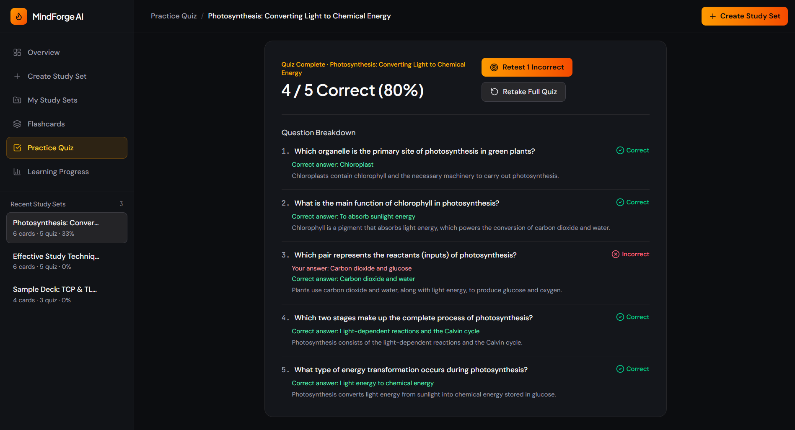
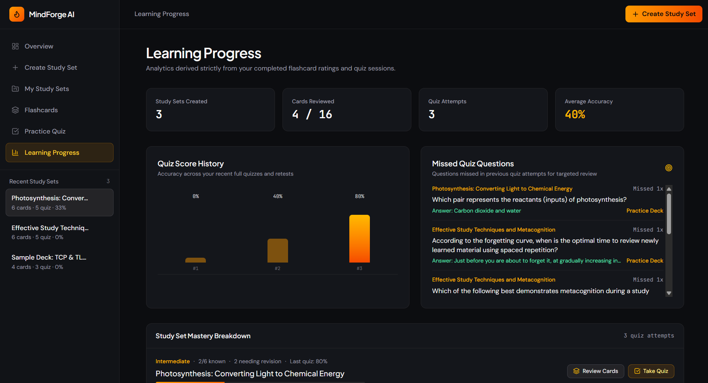

# MindForge AI — Interactive Study Assistant

<p align="center">
  <strong>Transform study notes into interactive learning experiences.</strong>
</p>

<p align="center">
  
  
  
  
  
  
</p>

<p align="center">
  
  
  
</p>

---

## Overview

MindForge AI is an interactive study assistant that transforms user-provided topics and study notes into structured flashcards and multiple-choice quizzes.

Designed around active recall and effective learning techniques, the application enables users to review concepts, test their understanding, revisit incorrect answers, and monitor their learning progress through an interactive dashboard.

## Features

### 01. AI-Powered Study Generation

* Enter any topic or paste free-form study notes.
* Generate structured flashcards and multiple-choice quizzes.
* Choose between Beginner, Intermediate, and Advanced difficulty.
* Configure flashcard and quiz quantities.
* Built-in sample topics for quick exploration.

### 02. Interactive Flashcards

* Interactive 3D card-flipping interface.
* Questions, answers, and hints.
* Track mastery using **Known** and **Needs Revision**.
* Shuffle and restart study sessions.
* Filter cards requiring revision.
* Keyboard navigation using Space and arrow keys.

### 03. Practice Quizzes

* Multiple-choice questions with four answer options.
* Immediate feedback and detailed explanations.
* Automatic scoring and result breakdown.
* Retest incorrect questions without repeating the entire quiz.

### 04. Learning Analytics

* Study sets and flashcard activity tracking.
* Flashcard mastery statistics.
* Quiz attempts and average accuracy.
* Quiz performance trends.
* Weak-topic identification through missed questions.
* Recent learning activity.

### 05. Reliability & User Experience

* Input validation and character limits.
* Structured AI response validation.
* Loading, error, and retry states.
* Request cancellation and timeout handling.
* Protection against stale asynchronous responses.
* Responsive desktop and mobile interface.

---

## Tech Stack

| Category       | Technologies                       |
| -------------- | ---------------------------------- |
| Frontend       | React 19, TypeScript               |
| Build Tool     | Vite                               |
| Styling        | Tailwind CSS v4                    |
| Icons          | Lucide React                       |
| Backend        | Node.js, Express.js                |
| AI Integration | Google Gemini API, `@google/genai` |
| Validation     | Zod                                |
| Security       | Helmet, CORS                       |
| Persistence    | Browser LocalStorage               |
| Testing        | Node.js Test Runner, `tsx`         |

---

## Application Architecture

```text
              USER INPUT
                  |
                  v
           REACT FRONTEND
                  |
                  v
             EXPRESS API
                  |
                  v
         REQUEST VALIDATION
                (Zod)
                  |
                  v
             GEMINI API
                  |
                  v
          STRUCTURED JSON
                  |
                  v
        RESPONSE VALIDATION
                  |
                  v
        FRONTEND VALIDATION
                  |
          +-------+-------+
          |       |       |
          v       v       v
      FLASHCARDS QUIZ  ANALYTICS
```

The application follows a client-server architecture. AI requests are processed through the Express backend, keeping API credentials separate from the frontend.

Generated content passes through backend schema validation and frontend contract validation before being rendered as interactive React components.

## Handling Unreliable AI Responses

Reliability is a core part of the application. Generated content and asynchronous requests are handled defensively to prevent unexpected model responses from breaking the user experience.

| Potential Issue              | Handling                                      |
| ---------------------------- | --------------------------------------------- |
| Malformed JSON               | Response parsing and validation               |
| Missing or incorrect fields  | Zod and frontend contract validation          |
| Empty generated content      | Schema-level validation                       |
| Duplicate quiz options       | Validation of four distinct options           |
| Invalid correct answer index | Range validation (`0–3`)                      |
| Slow requests                | Client and server timeouts                    |
| Failed API requests          | Structured error responses and retry handling |
| Request cancellation         | AbortController                               |
| Out-of-order responses       | Request sequence tracking                     |
| Excessive API requests       | IP-based rate limiting                        |

---

## Application Screenshots

<p align="center">
  <strong>Explore the MindForge AI experience</strong>
</p>

### Dashboard

Overview of study activity, learning statistics, and recent study sets.



### Interactive Flashcards

Review concepts using interactive cards, hints, and mastery tracking.



### Practice Quiz Results

View quiz performance, answer feedback, and options to retest incorrect questions.



### Learning Progress

Monitor study activity, quiz performance, and learning progress.



---

## Getting Started

### Prerequisites

* Node.js
* npm
* Google Gemini API key

### 1. Clone the repository

```bash
git clone https://github.com/returnzerovicky/mindforge-ai.git
cd mindforge-ai
```

### 2. Install dependencies

```bash
npm install
```

### 3. Configure environment variables

Create a `.env` file from the provided example.

**Windows PowerShell:**

```powershell
Copy-Item .env.example .env
```

**macOS / Linux:**

```bash
cp .env.example .env
```

Configure your `.env` file:

```env
GEMINI_API_KEY=your_gemini_api_key
PORT=3000
REQUEST_TIMEOUT_MS=60000
RATE_LIMIT_MAX=30
CORS_ORIGIN=""
```

Get your API key from [Google AI Studio](https://aistudio.google.com/apikey).

**Important:** Keep your `.env` file private. Never expose your Gemini API key through frontend environment variables or commit it to GitHub.

### 4. Run the application

```bash
npm run dev
```

Open **http://localhost:3000** in your browser.

### 5. Production build

```bash
npm run build
npm start
```

---

## Testing & Verification

Run automated tests:

```bash
npm test
```

Run TypeScript checks:

```bash
npm run lint
```

Build for production:

```bash
npm run build
```

### Verification Results

| Check                    | Result     |
| ------------------------ | ---------- |
| TypeScript type checking | Passed     |
| Automated tests          | 11 Passed  |
| Failed tests             | 0          |
| Production build         | Successful |

---

## Project Structure

```text
mindforge-ai/
├── public/
│   └── screenshots/
├── server/
│   ├── config/
│   ├── controllers/
│   ├── middleware/
│   ├── routes/
│   ├── services/
│   └── validators/
├── src/
│   ├── components/
│   ├── hooks/
│   ├── pages/
│   ├── services/
│   ├── types/
│   └── utils/
├── .env.example
├── .gitignore
├── package.json
├── server.ts
└── vite.config.ts
```

## Known Limitations

* **Browser-Local Persistence:** Study sets and activity logs are stored in browser LocalStorage. Clearing browser storage resets saved progress.
* **In-Memory Rate Limiting:** Rate limiting uses process memory and resets when the server restarts.
* **Text Input Only:** Study generation accepts pasted text or topics up to 12,000 characters. PDF and image uploads are not implemented.
* **No Authentication:** Multi-user accounts and cross-device synchronization are not included.

---

## Development Time

**Approximately 3 hours 45 minutes**

Includes core implementation, backend integration, UI/UX development, testing, and verification.

---

<p align="center">
  <strong>MindForge AI</strong>
  <br />
  <sub>Learn actively. Recall confidently. Make every study session count.</sub>
</p>
